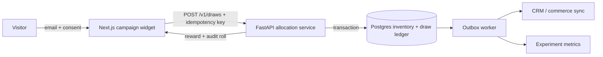

# Architecture

The published demo is a static Next.js export using shared fixtures. It computes a deterministic in-browser draw to prove UX while plainly labeling the non-persistent state. The Python service is the reference production boundary and is not live on Pages.

## API contract

`POST /v1/draws` accepts a valid email, explicit consent, bounded seed, and 2–20 unique prizes with weight and inventory. It rejects malformed email, absent consent, invalid weights, duplicate IDs, or all-depleted inventory with HTTP 422. It selects only in-stock inventory and returns prize ID, label, code, audit roll, and remaining inventory.

Production adds authenticated campaign lookup, server-generated cryptographic randomness, idempotency, atomic row locking, reward code reservation, rate limits, fraud scoring, and generic client errors. Never trust browser-supplied odds or inventory.

## Observability and failure paths

Metrics: validation rejection rate by reason, allocation latency/error rate, depleted-prize fallbacks, inventory drift, duplicate idempotency conflicts, view-to-submit/play/redeem funnel, prize cost, and holdout lift. Alert on any negative inventory, duplicate reward code, sustained allocation errors, or event/ledger mismatch. A failed draw shows a retryable named error and issues no reward; analytics outages use an outbox and cannot block allocation.
